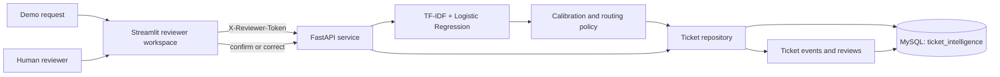

# AI Support Ticket Intelligence Platform

## Project documentation

This document describes the implemented platform, its model and routing policy,
data flow, database, API, reviewer workspace, local setup, verification, and known
limits. It is the main technical overview; the linked documents contain deeper
evaluation and operating details.

## 1. Purpose and scope

The platform is a local banking-support ticket triage prototype. It accepts an
English-language support request, predicts one of 77 Banking77 intents, and either
suggests assignment to a project-defined demonstration team or sends the ticket
to a human reviewer. Reviewers can confirm or correct the category and record a
status change. MySQL stores the original model suggestion, current ticket state,
review decisions, and event history.

The project demonstrates a complete applied ML workflow: data auditing and
partitioning, model comparison, probability calibration, a selective routing
policy, a protected API, relational persistence, an operations dashboard,
evaluation reports, and repeatable local development scripts.

This is not connected to a bank. It does not identify which bank issued a card,
inspect payment-network data, contact bank staff, change a payment, issue a refund,
verify an account, or determine real urgency or resolution time. Team assignments
are explicit demo mappings maintained in `configs/team_mapping.json`.

## 2. Main capabilities

- Classifies requests into 77 banking intent categories and returns the top three
  category suggestions.
- Uses a frozen confidence policy to make a demo-team suggestion when the request
  passes the assignment checks; otherwise it leaves the ticket for human review.
- Persists tickets and audit history in MySQL.
- Provides an authenticated FastAPI service and a Streamlit reviewer workspace.
- Supports inbox filters, pagination, reviewer corrections, conflict protection,
  ticket history, and workflow activity counts.
- Can send minimal, signed ticket-created/reviewed events to an optional webhook
  workflow for connection to an approved helpdesk or team notification system.
- Includes reproducible model/data reports, a separately authored challenge set,
  tests, local start/stop scripts, and a MySQL Workbench SQL script.

## 3. Architecture and request lifecycle



1. A user submits request text through the dashboard or `POST /tickets`.
2. The API validates and trims the text, then gets category scores from the
   selected classifier.
3. If a frozen routing policy is loaded, the policy calibrates the scores and
   applies the confidence, margin, known-vocabulary, and multi-team checks.
4. The configured mapping turns the chosen intent into one of five demo teams.
   A request that fails a check is saved as `needs_review` with no assigned team.
5. The API saves the original prediction, initial state, and a `triaged` event in
   MySQL, then returns the persistent ticket ID.
6. A reviewer opens the ticket, sees the original suggestion and history, and
   confirms or corrects its category. The server derives the team from the
   confirmed category, updates the ticket version, and records a review and a
   `reviewed` event in one database transaction.
7. If another reviewer has already changed the ticket, the outdated version is
   rejected with HTTP 409; the first decision and history remain intact.

If the routing policy is missing or inactive, new requests go to human review.
The original prediction is retained when reviewers change the current category or
status, so the model output and later human decision remain distinguishable.

## 4. Machine-learning pipeline

### Data

The classifier uses the English Banking77 intent dataset: 10,003 official training
requests, 3,080 official test requests, and 77 intent labels. The training set is
partitioned into 7,000 fit examples and three separate 1,001-example partitions
for development, calibration, and routing-policy selection. Normalized duplicate
text groups are kept within a partition. The official test set is reserved for
final evaluation after the choices are frozen.

One hundred separately authored challenge requests cover clearly unrelated
requests, nearby unsupported banking requests, ambiguous supported requests, and
multi-intent requests. There are 48 policy-development examples and 52 held-out
examples. These are diagnostic scenarios, not real customer traffic or additional
Banking77 labels. The data audit also found seven normalized text groups shared by
the publisher's original train and test partitions; the official split was
preserved and the overlap is disclosed in the evaluation evidence.

### Model comparison and selected model

The baseline represents text with lowercase word-level TF-IDF unigrams and
bigrams, sublinear term frequency, and a scikit-learn pipeline. It compares
Logistic Regression and Multinomial Naive Bayes using fit and development data.
The deployment selection is Logistic Regression with `C=10`; Naive Bayes remains
as a baseline. A frozen DistilBERT feature model with a trained linear head was
also compared, but the encoder itself was not fine-tuned.

Development macro-F1 was 86.44% for Logistic Regression, 80.44% for Naive Bayes,
and 85.45% for frozen DistilBERT. Logistic Regression was retained because it led
development macro-F1 and accuracy while using smaller artifacts and lower measured
local inference latency. These are selection results, separate from the final
test results below.

### Confidence and assignment policy

The selected model always ranks one of its known 77 classes, even for unrelated or
unclear text. Its top class by itself does not establish that the request is
supported. A single temperature parameter, approximately `0.58584`, was fitted on
the calibration partition. The frozen policy uses a confidence threshold of
`0.70`, a top-two score margin of `0.20`, and a fixed heuristic guard for requests
whose clauses strongly suggest multiple demonstration teams.

With an active policy, a ticket is assigned only when it has known vocabulary
features, does not trigger the multi-team guard, reaches the confidence threshold,
and exceeds the runner-up by the required margin. Otherwise it is saved for
review. If the policy is absent or inactive, all requests go to review. The
multi-team check is a heuristic, not a complete multi-intent detector.

The intent-to-team mapping is defined explicitly for all labels in
`configs/team_mapping.json`. Its five demonstration teams are Card Operations,
Payments and Transfers, Cash and ATM Support, Account Support, and General Review.
It does not represent verified bank departments or payment-network ownership.

### Frozen final evaluation

On the reserved 3,080-example official test set, the frozen classifier achieved:

| Measure | Result |
|---|---:|
| Intent accuracy | 87.60% |
| Macro-F1 | 87.62% |
| Top-three accuracy | 96.23% |
| Project-defined demo-team accuracy | 96.10% |
| Automatic assignment coverage | 82.69% (2,547 of 3,080) |
| Accuracy among automatically assigned: intent | 95.09% |
| Accuracy among automatically assigned: demo team | 98.90% |

Coverage is reported alongside selective accuracy: the accepted-subset accuracy
does not describe the 533 reviewed requests or all future traffic. Its 95% Wilson
interval for accepted-intent accuracy was 94.18%–95.87%, so it includes values
below the 95% point target.

The system reviewed 45 of 52 held-out authored challenge requests (86.54% review
recall). Review recall for ambiguous supported requests was 69.23%, below the
75% development target. The policy was not retuned against the held-out challenge
set. The challenge set is small and balanced by design; it cannot estimate
production prevalence, reviewer workload, or review precision. See the
[frozen evaluation](../reports/final/RESULTS.md),
[model card](MODEL_CARD.md), and [evaluation protocol](EVALUATION_PROTOCOL.md)
for confidence intervals, per-class evidence, and interpretation details.

## 5. MySQL data model

The application database is named `ticket_intelligence`. The local application
uses MySQL; PostgreSQL support remains only in the one-time migration utility and
the preserved local source copy. On this workstation, the saved MySQL Workbench
connection named `DK` points to the same local MySQL server at `127.0.0.1:3306`;
the app connects to that server through its private application account.

| Table | Purpose | Important fields |
|---|---|---|
| `tickets` | Current ticket state and immutable original suggestion | UUID `id`, request `text`, UTC timestamps, `status`, optimistic `version`, JSON `prediction`, `current_category`, nullable `assigned_team`, `model_version`, `confidence` |
| `ticket_events` | Workflow event trail; the application records new events for state changes | Auto-increment `id`, `ticket_id`, event `type`, UTC `created_at`, `actor_id`, JSON `payload` |
| `ticket_reviews` | Reviewer decisions and before/after snapshots | Auto-increment `id`, `ticket_id`, UTC `created_at`, `reviewer_id`, `note`, JSON `before_state`, JSON `after_state` |

Tables use InnoDB, UTF-8 (`utf8mb4`), foreign keys from history to tickets,
status/version/confidence checks, and indexes for inbox queries. Database
timestamps are stored at microsecond precision in UTC; the dashboard displays
times in India Standard Time. Ticket states are `needs_review`, `assigned`, and
`resolved`.

The application creates the initial schema at API startup. For MySQL Workbench,
open [`sql/ticket_intelligence_workbench.sql`](../sql/ticket_intelligence_workbench.sql),
connect using the local **DK** connection, refresh **SCHEMAS**, and expand
`ticket_intelligence`. The script uses `CREATE TABLE IF NOT EXISTS`; it does not
drop tables or overwrite ticket rows. It also includes row-count and recent-record
queries for inspection.

## 6. Optional support-system integration

Set both `TICKET_WEBHOOK_URL` and `TICKET_WEBHOOK_SECRET` to enable outbound
notifications. The API sends ticket-created and reviewer-updated events after the
database commit. Events contain the ticket ID, category, state, assigned demo
team, model version, confidence, and version number. They intentionally omit the
customer's request text, reviewer notes, reviewer token, and database credentials.
Each JSON body is signed with HMAC-SHA256 in `X-Ticket-Signature` and includes an
idempotency key in `X-Ticket-Event-ID`. HTTPS is required except for loopback URLs
in development. If either setting is missing, delivery stays disabled.

This is a provider-neutral webhook bridge, not a preconfigured native Zendesk,
Freshdesk, Slack, or WhatsApp connector. A receiving workflow can verify the
signature and map events to the destination provider's API. Delivery is best
effort after the ticket commit; failures are logged without rolling back the
ticket and are not retried automatically. Do not configure a destination until
its owner has approved the data fields and retention behavior.

The implementation lives in `src/ticket_intelligence/integrations/webhooks.py`
and is independent of the MySQL persistence layer.

## 7. HTTP API

Base URL in the local setup: `http://127.0.0.1:8000`. Interactive API docs are at
`/docs`. Ticket and prediction operations require the `X-Reviewer-Token` header;
`/health` and `/ready` are service checks.

| Method and path | Authentication | Purpose |
|---|---|---|
| `GET /` | No | Service name and version |
| `GET /health` | No | Process health; does not prove dependencies are ready |
| `GET /ready` | No | Model, database, reviewer-auth, and policy availability |
| `GET /metadata` | Yes | Supported categories, demo teams, and active policy metadata |
| `POST /predict` | Yes | Return intent candidates and proposed routing without saving a ticket |
| `POST /tickets` | Yes | Classify, route/review, and persist a ticket; responds HTTP 201 |
| `GET /tickets` | Yes | Paginated list; optional `status`, `team`, `limit`, and `offset` filters |
| `GET /tickets/{ticket_id}` | Yes | Ticket detail, original prediction, events, and reviews |
| `POST /tickets/{ticket_id}/reviews` | Yes | Confirm/correct category, save note, and set `assigned` or `resolved` |
| `GET /metrics` | Yes | Saved-ticket and reviewer-activity counts |

Request text is limited to 2,000 characters. A review includes the version shown
to the reviewer, a supported category, a status of `assigned` or `resolved`, and a
note up to 1,000 characters. The API derives the team from the configured mapping;
clients cannot independently choose an arbitrary team. A stale version returns
HTTP 409. Invalid requests/categories/teams return HTTP 400; missing or invalid
reviewer credentials return HTTP 503 or 401 respectively. A valid JSON review
request has this shape:

```json
{
  "expected_version": 1,
  "category": "declined_card_payment",
  "status": "assigned",
  "note": "Confirmed the payment failure category for this demo ticket."
}
```

## 8. Reviewer workspace

The Streamlit interface runs at `http://127.0.0.1:8501` and communicates with the
API; it does not perform model inference or write directly to MySQL. Its main
areas are:

- **Submit request:** enter fictional English support text or populate a sample,
  create a ticket, and inspect its saved ID and original model suggestion.
- **Ticket inbox:** filter by status/team, page through results, inspect a ticket,
  compare the original prediction with current state, confirm/correct its
  category, choose a workflow status, and record a reviewer note.
- **Dashboard:** view ticket totals by state/team and reviewer decision count.
  These charts describe workflow activity; they are not model accuracy or proof
  that a bank action succeeded.

The UI uses one server-side reviewer credential and has no browser login or
individual reviewer identity flow. Reviewer identity is configured for the local
demo. Do not expose this prototype publicly without adding appropriate access
control.

## 9. Technology and repository layout

| Area | Implementation |
|---|---|
| Language | Python 3.11 or 3.12 |
| Text processing/model | pandas, NumPy, scikit-learn TF-IDF, Logistic Regression, Multinomial Naive Bayes |
| Optional comparison | PyTorch/Transformers frozen DistilBERT features |
| API | FastAPI, Pydantic, Uvicorn |
| UI | Streamlit, pandas charts |
| Database | MySQL, SQLAlchemy 2, PyMySQL |
| Verification | pytest, Ruff, focused integration scripts |
| Local containers | Docker Compose with MySQL 8.4, API, dashboard |

```text
src/ticket_intelligence/
  api/          FastAPI routes and request schemas
  core/         validated settings
  data/         pinned download, audit, grouped partitions
  db/           SQLAlchemy models, sessions, repository, PG-to-MySQL migration
  integrations/ optional signed outbound support-system webhooks
  inference/    verified model loading, prediction, calibration and routing
  training/     baseline comparison, routing selection, transformer comparison
ui/             Streamlit reviewer workspace
configs/        intent/team mapping and model-selection records
data/           local source, partitions and authored challenges (ignored by Git)
artifacts/      trained model and frozen policy bundles (local artifacts)
reports/        aggregate evaluation and data-audit evidence; local probes stay untracked
sql/            MySQL Workbench setup and inspection script
scripts/        setup, service lifecycle, verification and reporting utilities
tests/          model, data, API, repository, policy and contract tests
docs/           scope, model/data/evaluation and runbook documents
```

## 10. Run locally on Windows

The current workspace has its Python virtual environment and MySQL configuration
already prepared. From the repository root, start and stop the app with:

```powershell
& .\scripts\start-local.ps1
# Open http://127.0.0.1:8501
# API docs: http://127.0.0.1:8000/docs
& .\scripts\stop-local.ps1
```

The start script checks that ports 8000 and 8501 are available, verifies/provisions
the local MySQL application connection, then launches the API and dashboard in
hidden processes. It records only the process identities needed by the matching
stop script. Stopping the project leaves MySQL running. Logs and local process
records are under the ignored `.runtime` folder.

For a new checkout, follow [`LOCAL_SETUP.md`](LOCAL_SETUP.md). In summary: create
`.venv`, install the project and development dependencies, create a private `.env`
from `.env.example`, download and prepare the pinned Banking77 data, train the
baseline, create the frozen routing policy, configure MySQL, then start the app.
The setup helper can request a MySQL administrator password in a hidden terminal
prompt; keep credentials in the private local environment and never commit `.env`.

Useful local commands:

```powershell
.\.venv\Scripts\python.exe -m pytest -q
.\.venv\Scripts\python.exe -m ruff check .
.\.venv\Scripts\python.exe scripts\verify_mysql.py
.\.venv\Scripts\python.exe scripts\verify_workflow.py
.\.venv\Scripts\python.exe scripts\verify_ui.py
```

Integration verifiers create demonstration tickets and reviewer history. Run them
against a development database, not data you need to preserve. See
[`DEMO_WALKTHROUGH.md`](DEMO_WALKTHROUGH.md) for a safe presentation sequence.
The repository also includes a GitHub Actions quality workflow for Python 3.11
and 3.12; a hosted result is available after the repository is pushed and the
workflow runs.

## 11. Configuration and security

Settings come from `TICKET_*` environment variables or `.env`; process environment
values take precedence. Important settings include:

| Setting | Purpose |
|---|---|
| `TICKET_DATABASE_URL` | SQLAlchemy MySQL URL for the app database |
| `TICKET_REVIEWER_TOKEN` | Shared server-side credential for protected API calls |
| `TICKET_REVIEWER_ID` | Demo reviewer identity written to history |
| `TICKET_API_HOST`, `TICKET_API_PORT` | API bind address and port; local defaults use loopback and 8000 |
| `TICKET_API_BASE_URL` | API address used by the Streamlit server |
| `TICKET_ARTIFACT_DIR` | Verified model bundle directory |
| `TICKET_TEAM_MAPPING_PATH` | Explicit demo intent/team mapping |
| `TICKET_POLICY_PATH` | Frozen routing policy file |

The local `.env`, `.env.compose`, credentials, datasets, trained model binaries,
and runtime process records are private local files and should stay untracked.
The local MySQL app account is scoped to the project database. The optional
Compose setup uses separate generated secrets, keeps MySQL and API ports private
to the Compose network, and publishes the dashboard only on host loopback
(`127.0.0.1:8501`). The local Compose service is not a cloud/public deployment.

Before production, the system needs individual user authentication and roles,
secure secret management, TLS, backups/restore tests, an approved operational
team directory, privacy/retention decisions, audit monitoring, and a deployment
and migration plan. Loading a checksum-verified model does not make an untrusted
pickle safe; use only model artifacts created by this project or a trusted source.

## 12. Known limitations and next steps

- The model is a single-label, English Banking77 classifier. It does not detect
  every unsupported request, resolve multiple independent issues, or understand
  a complete account/transaction history.
- Confidence calibration improves score scaling but does not turn a closed-set
  classifier into a robust out-of-domain detector.
- The multi-team guard inspects a limited set of text clauses and can miss or
  over-flag cases. Challenge results show lower-than-target review recall for
  ambiguous supported requests.
- Banking77 has no urgency, real support-team, transaction outcome, refund
  eligibility, SLA, or resolution-time labels. The project cannot train or claim
  those capabilities from this dataset.
- Human corrections are audited but are not automatically added to training or
  evaluation, preventing unreviewed workflow activity from silently changing
  model quality claims.
- Team mapping is a hand-authored demo rule. A real support operation would need
  approved ownership rules and current case context; a card decline alone cannot
  identify a bank or guarantee the right operational resolver.
- Demo counts, test accuracy, and local latency do not predict production
  prevalence, throughput, staffing demand, or outcomes.

Potential next milestones are a genuine reviewer sign-in/roles system, supervised
multi-intent handling, independently sampled in-domain and unsupported-request
validation data, an approved real-team directory, monitored model/policy
performance, and a separately secured deployment. Any policy change should be
validated on new data rather than repeatedly tuned against the reported holdout.

## 13. Related project references

- [Local setup and container runbook](LOCAL_SETUP.md)
- [Demonstration workflow](DEMO_WALKTHROUGH.md)
- [Project scope and intended use](PROJECT_SCOPE.md)
- [Banking77 data card](DATA_CARD.md)
- [Model card](MODEL_CARD.md)
- [Frozen evaluation protocol](EVALUATION_PROTOCOL.md)
- [Authored challenge-set card](CHALLENGE_SET.md)
- [Build and verification progress](BUILD_PROGRESS.md)
- [Workbench SQL script](../sql/ticket_intelligence_workbench.sql)
- [Final frozen evaluation results](../reports/final/RESULTS.md)
